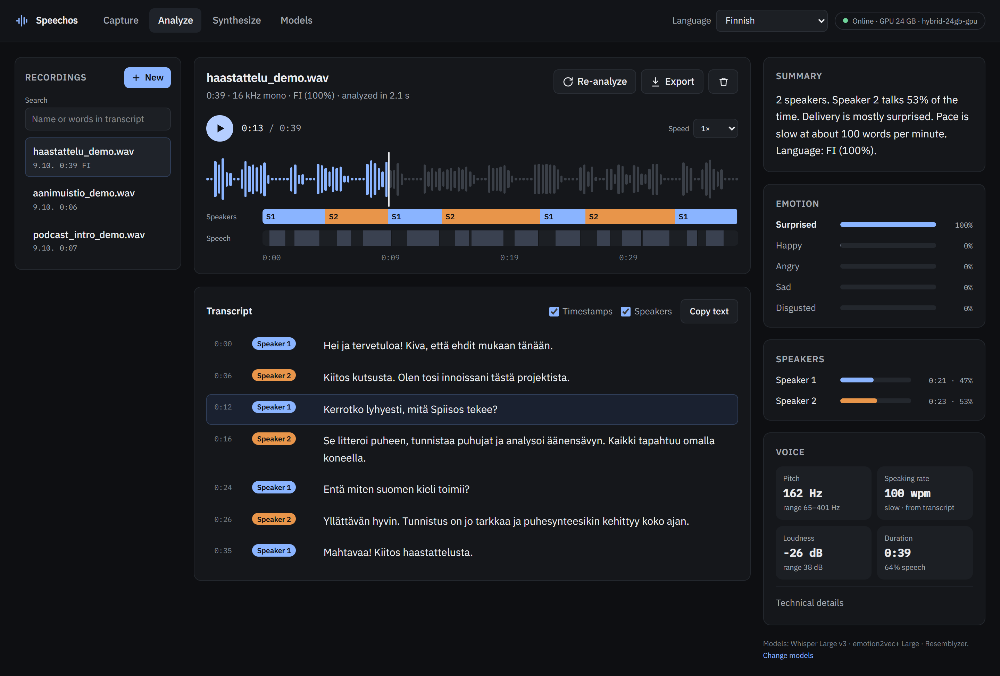
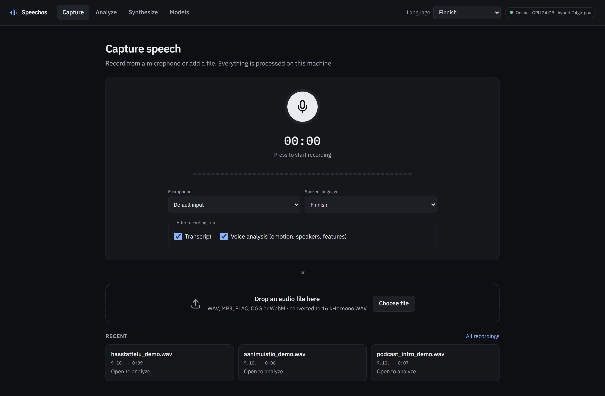
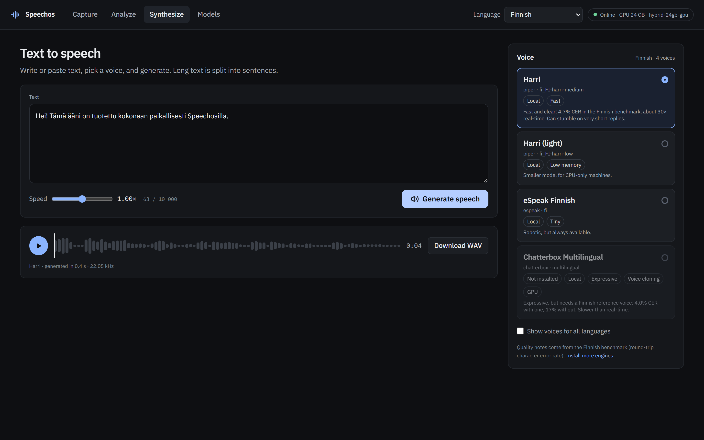
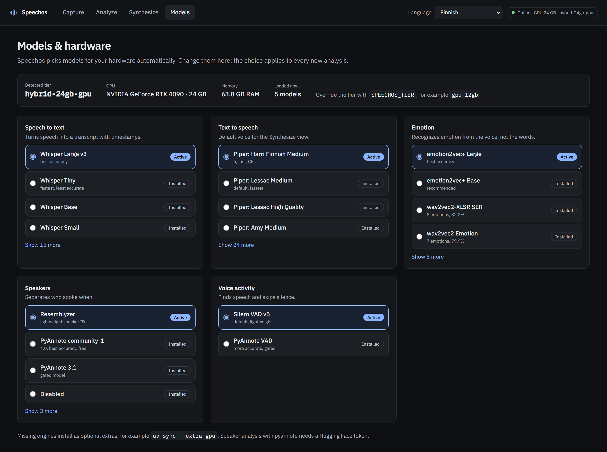
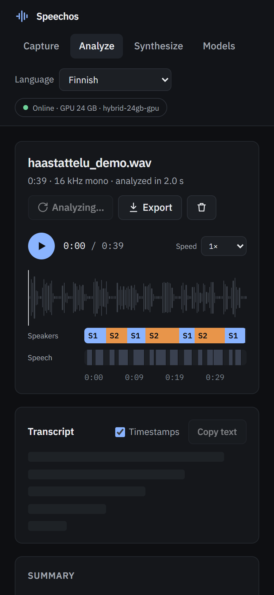

# Speechos

Local-first speech analysis and synthesis. Record or upload speech, get a transcript with speakers, emotion and voice
features, and turn text back into speech — all on your own machine, with no cloud calls. Finnish is the default
language; English and automatic detection are one click away.



## Features

| View | What it does |
|---|---|
| **Capture** | Record from any microphone with a live level meter, or drop in an audio file (WAV, MP3, FLAC, OGG, WebM). Everything is stored as 16 kHz mono WAV. |
| **Analyze** | Waveform with speaker and speech-activity lanes, a transcript you can click to jump in the audio, and insights: summary, emotion, speakers, pitch, speaking rate and loudness. Export to TXT, SRT or JSON. |
| **Synthesize** | Text to speech with voices filtered by language, speed control, waveform preview and WAV download. Finnish voices carry quality notes from the benchmark. |
| **Models** | Hardware tier and per-category model choice (speech-to-text, text-to-speech, emotion, speakers, voice activity) with install status. |

<table>
  <tr>
    <td width="50%"></td>
    <td width="50%"></td>
  </tr>
  <tr>
    <td width="50%"></td>
    <td width="50%" align="center"></td>
  </tr>
</table>

The screenshots use synthetic demo recordings.

## Quick start

### Prerequisites

- **Node.js** 22+ and **pnpm** (`npm install -g pnpm`)
- **Python** 3.11–3.13 and **uv** ([install guide](https://docs.astral.sh/uv/getting-started/installation/))
- Optional: an NVIDIA GPU with CUDA 12.8 drivers. Everything also runs on CPU, with smaller models.
- FFmpeg is not needed: non-WAV input is decoded with PyAV.

### 1. Install

```bash
cd web && pnpm install && cd ..
cd api && uv sync --extra gpu && cd ..   # --extra gpu adds pyannote and ModelScope; omit on CPU-only machines
cp .env.example .env                       # optional: HF_TOKEN for pyannote diarization
```

### 2. Run

```powershell
.\dev.ps1            # Windows: API + web, Ctrl+C stops both process trees
```

```bash
./dev.sh             # Linux / WSL2 / macOS: same, with --api or --web for one of them
```

```bash
pnpm dev:api         # API only  (cd api && uv run python -m src)
pnpm dev:web         # web only
```

- Web UI: [http://localhost:36301](http://localhost:36301)
- API: [http://localhost:36300](http://localhost:36300) (interactive docs at `/docs`)

The header shows whether the API is online and which hardware tier it picked. Pick the language there; the choice is
remembered.

## Finnish speech quality

Speechos ships a Finnish benchmark (`api/bench/`) that drives its defaults. Results from October 2026 on an RTX 4090:

| Speech to text (FLEURS-fi, 300 clips) | WER | CER | Real-time factor |
|---|---:|---:|---:|
| [Finnish-NLP/whisper-large-finnish-v3](https://huggingface.co/Finnish-NLP/whisper-large-finnish-v3) (CTranslate2) | **6.2 %** | 1.43 % | 0.044 |
| faster-whisper large-v3 (default) | 7.5 % | 1.53 % | 0.044 |
| faster-whisper large-v3-turbo | 8.1 % | 1.65 % | 0.018 |

| Text to speech (round trip, 38 sentences × 3 seeds) | CER | Real-time factor | Notes |
|---|---:|---:|---|
| Piper `fi_FI-harri-medium` (default) | 4.65 % ± 1.33 | 0.036 | Fastest, runs on CPU; garbles some short replies (e.g. "Ymmärrän.") |
| Chatterbox-Finnish + Finnish reference voice (CUDA graph) | 3.29 % ± 0.26 | 0.43 | Most natural local voice; optional engine, ~4.4 GB VRAM |
| eSpeak-NG Finnish | 9.94 % | 0.02 | Robotic fallback |

**Finnish Whisper.** On GPU tiers that run large-v3, requests with `language=fi` use whisper-large-finnish-v3
automatically once its CTranslate2 conversion is on disk; other languages keep large-v3. One-time setup (3.1 GB):

```bash
cd api   # the API environment already has transformers, torch and ctranslate2
uv run hf download Finnish-NLP/whisper-large-finnish-v3 \
  --revision b23deb0b3855c829ffe04cb1c6709757ff16d49c --local-dir ../models/whisper-large-finnish-v3
uv run ct2-transformers-converter --model ../models/whisper-large-finnish-v3 \
  --output_dir ../models/whisper-ct2/whisper-large-finnish-v3-ct2-f16 \
  --quantization float16 --copy_files tokenizer.json preprocessor_config.json
```

Turn it off with `SPEECHOS_STT_FI_ENGINE=none`, or point `stt_fi` in `config.yaml` at another model.

**Chatterbox-Finnish.** Install with `uv sync --extra tts-fi` and pick it under Models → Text to speech or in the
Synthesize view. It downloads about 4 GB on first use, clones a voice from a Finnish reference clip, and reads numbers,
dates and abbreviations through a Finnish text normalizer (also used in front of Piper).

Full method, all engines and how to reproduce: [api/bench/README.md](api/bench/README.md).

```bash
cd api && uv sync --extra bench
uv run python bench/stt_fi.py --models large-v3 --datasets fleurs --n 100
uv run python bench/tts_fi.py --engines piper-fi espeak-fi
```

## Hardware tiers

The API detects GPU, VRAM and RAM and picks models per tier:

| Tier | Speech to text | Emotion | Speakers |
|---|---|---|---|
| `cpu-2gb` … `cpu-32gb` | Whisper tiny … medium (int8) | — | — |
| `gpu-4gb` | Whisper small (fp16) | — | — |
| `gpu-8gb` | Whisper turbo | emotion2vec+ base | — |
| `gpu-12gb` | Whisper large-v3 (int8/fp16) | emotion2vec+ base | pyannote or Resemblyzer |
| `gpu-24gb`, `gpu-32gb` | Whisper large-v3 (fp16) | emotion2vec+ large | pyannote or Resemblyzer |

`hybrid-*-gpu` tiers (GPU plus at least 8 GB RAM) use the same models as the matching `gpu-*` tier. Text to speech is
Piper (Finnish Harri, English Lessac) on every tier. Speaker analysis uses pyannote community-1 when
`HF_TOKEN` is set and its terms are accepted; otherwise it falls back to Resemblyzer automatically.

Overrides:

```bash
SPEECHOS_TIER=gpu-12gb pnpm dev:api       # force a tier
SPEECHOS_COMPUTE_MODE=cpu pnpm dev:api    # ignore the GPU
SPEECHOS_STT_MODEL=large-v3 pnpm dev:api  # override one model
cp config.example.yaml config.yaml        # or use a config file
```

All tiers and overrides: [docs/architecture/HARDWARE-TIERS.md](docs/architecture/HARDWARE-TIERS.md).

## API

| Method | Path | Description |
|---|---|---|
| `GET` | `/health` | Health check |
| `POST` | `/api/transcribe` | Audio (+ optional `language`, e.g. `fi`) → transcript with segments |
| `POST` | `/api/synthesize` | `{text, language?, speed?, voice?}` → WAV |
| `POST` | `/api/analyze` | Audio → features, emotion, speakers, speech activity |
| `GET` | `/api/recordings` | List saved recordings |
| `POST` | `/api/recordings` | Upload a recording (stored as 16 kHz mono WAV) |
| `GET` | `/api/recordings/:id/audio` | Download a recording |
| `DELETE` | `/api/recordings/:id` | Delete a recording |
| `GET` | `/api/system/info` | Hardware profile, tier, loaded models |
| `GET` | `/api/system/model-options` | Selectable models per category |
| `POST` | `/api/system/switch-model` | Switch a model at runtime |

Full reference: [docs/architecture/ARCHITECTURE.md](docs/architecture/ARCHITECTURE.md).

## Development

```bash
cd api
uv sync --extra dev
uv run pytest                    # unit tests: no GPU, no model downloads
uv run pytest -m models          # real-model smoke tests (downloads weights)
uv run ruff check src tests

cd ../web
pnpm lint && pnpm typecheck && pnpm build
```

CI (`.github/workflows/ci.yml`) runs the API tests and lint on Python 3.12 without torch, and lint, typecheck and
build for the web app on Node 22.

```
speechos/
├── api/                 FastAPI backend (uv)
│   ├── src/             server, config/tiers, model manager, audio, analysis, routers
│   ├── tests/           pytest suite
│   └── bench/           Finnish STT/TTS benchmark
├── web/                 Next.js frontend (pnpm)
│   └── src/app/         capture, analyze, synthesize, models
├── docker/              Dockerfiles, compose files, nginx
├── docs/                architecture, research, plans, screenshots
└── samples/             sample WAV files
```

## Docker

Docker is optional; use it for deployment.

```bash
docker compose -f docker/docker-compose.gpu.yml up --build   # needs the NVIDIA Container Toolkit
docker compose -f docker/docker-compose.cpu.yml up --build   # CPU only
./start.sh   # or .\start.ps1 on Windows: picks GPU or CPU automatically
```

The web image bakes in the API URL the browser uses (`SPEECHOS_PUBLIC_API_URL`, default `http://localhost:36300`).

## Tech stack

- **Web**: Next.js 16, React 19, TypeScript, Tailwind CSS 4
- **API**: Python 3.11–3.13, FastAPI, uvicorn, PyTorch 2.11 (CUDA 12.8 or CPU)
- **Speech to text**: faster-whisper (Vosk, WhisperX, NeMo and others selectable)
- **Text to speech**: Piper (Kokoro, Chatterbox, Kitten, eSpeak-NG and Docker engines selectable)
- **Analysis**: librosa, emotion2vec+, pyannote / Resemblyzer, Silero VAD
- **Tooling**: pnpm, uv, ruff, ESLint, GitHub Actions

## License

[MIT](LICENSE). Models and engines keep their own licenses: for example `piper-tts` is GPL-3.0, and some benchmark-only
models (MMS-TTS, Nord-Parl-TTS derivatives) are non-commercial. See [api/bench/README.md](api/bench/README.md) for the
license of each benchmarked model.
